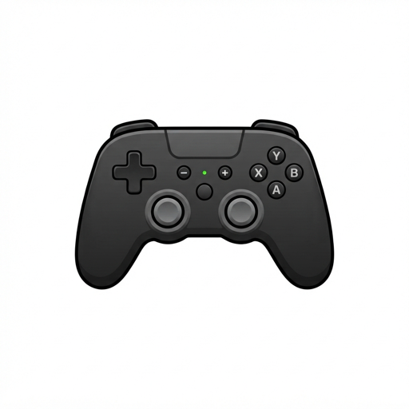

<p align="center">
  
</p>

<h1 align="center">DSX</h1>

<p align="center">
  A tiny macOS menu bar utility that makes PlayStation controllers behave the way they should.
</p>

<p align="center">
  
  
  
</p>

---

DSX (formerly [DS3Activator](https://github.com/jamesy0ung/DS3Activator)) started as a workaround for one specific bug: since macOS Monterey, a DualShock 3 plugged in over USB is detected but never activated, so games see a dead controller. DSX sends the missing activation command automatically and then grew into a small controller companion for Sony pads.

It runs entirely in the menu bar, does not poll, and uses Apple's `IOKit.hid` APIs directly, no kernel extensions, no helper daemons, no third-party libraries.

## What it does

| Controller | Product IDs | Connection | What DSX handles |
| --- | --- | --- | --- |
| **DualShock 3** | `0x0268` | USB | Activation + player LED |
| **DualShock 4** | `0x05C4`, `0x09CC`, `0x081F` | USB, Bluetooth | Lightbar + battery |
| **DualSense** | `0x0CE6`, `0x0DF2` (Edge) | USB, Bluetooth | Lightbar, player LEDs, battery |

### DualShock 3 activation

On macOS 12+, the system enumerates a DS3 but never sends the HID feature report that puts it into a usable state. On connect, DSX:

1. Opens the device exclusively.
2. Sends feature report `0xF4` with payload `42 0C 00 00`.
3. Sends output report `0x01` to light the player LED.
4. Releases the device so games and emulators can use it.

### Player numbers and colours

Controllers are assigned the lowest free player slot (1–4) when they connect, and the slot stays stable until they disconnect,like a console.

- **Player 1** uses the lightbar colour you pick in Settings (default blue).
- **Players 2–4** get red, green, and pink so pads are easy to tell apart.
- **DualShock 3** lights the matching LED via the bitmask at output byte 9.
- **DualSense** uses the PS5 player LED patterns on its five-LED strip.

### Battery status

The menu shows the battery percentage and charging state for DualShock 4 and DualSense, parsed from their input reports. Bluetooth DualSense pads are switched from the truncated `0x01` report to the full `0x31` report so battery data is actually available.

```
DSX
────────────────────────────
Connected Controllers
  P1  DualSense,Bluetooth,85% charging
  P2  DualShock 4,USB,60%
────────────────────────────
Settings…                  ⌘,
────────────────────────────
Quit                       ⌘Q
```

### The Bluetooth white pulse

macOS leaves a Bluetooth DualShock 4 pulsing white indefinitely because it never sends a lightbar command. DSX sends a solid colour once the pad finishes connecting and retries if the controller refuses early writes. DualSense pads get the same retry handling, spaced past their own connection animation.

### Everything else

- **Menu bar only**,no Dock icon, no windows until you open Settings.
- **Notifications** for connections, activation, and lightbar failures, with an optional verbose mode.
- **Launch at login** via `SMAppService`.
- **Sandboxed**, with USB and Bluetooth device access declared in its entitlements.
- **No idle polling**,IOKit callbacks wake the app only when something happens.

## Requirements

- macOS 15.4 or later
- Xcode 16.3 or later to build
- A supported Sony controller (see the table above)

## Build and run

```sh
git clone https://github.com/jamesy0ung/DS3Activator.git
cd DS3Activator
open DSX.xcodeproj
```

Select the **DSX** scheme and press **⌘R**. The app has no external dependencies, so there is nothing to resolve or install.

To run it outside Xcode, archive the app and move it to `/Applications`. If you build with your own signing identity, set your team under **Signing & Capabilities**; the entitlements file already declares the USB and Bluetooth access the app needs.

## Usage

1. Launch **DSX**. A game controller icon appears in the menu bar.
2. Connect a controller over USB or pair it over Bluetooth.
3. The menu lists it with its player number, transport, and battery level.
4. Open **Settings…** to pick the player 1 colour, toggle notifications, or enable launch at login.

Changing the colour applies immediately to every connected DualShock 4 and DualSense.

## How the reports are built

All report layouts live in [`ControllerLightReports.swift`](DSX/ControllerLightReports.swift) and are kept separate from the IOKit plumbing so the bytes can be tested directly.

- **DualShock 4**,output report `0x05` over USB (32 bytes, RGB at 6–8); output report `0x11` over Bluetooth (78 bytes, RGB at 8–10) with a CRC-32 over an `0xA2` prefix and the first 74 bytes.
- **DualSense**,output report `0x02` over USB (48 bytes) wrapping a 47-byte effects payload; report `0x31` over Bluetooth with the same CRC scheme. Lightbar enable is `0x14` in the effects flags, player LEDs at offset 43, RGB at 44–46.
- **Battery**,DualShock 4 status byte at offset 30 (+2 over Bluetooth); DualSense at offset 53 (+1 over Bluetooth).
- macOS expects the report ID as the **first byte of the buffer** for numbered reports, in addition to the `reportID` argument,the buffers above include it.

## Project layout

```
DSX.xcodeproj/               Xcode project (target and scheme: DSX)
DSX/
  DS3ActivatorApp.swift      App delegate, menu bar, settings UI, notifications
  ControllerSupport.swift    Controller types, product IDs, HID matching
  ControllerHIDMonitor.swift Device matching/removal + input report callbacks
  ControllerConfiguration.swift  Activation and light orchestration
  ControllerLightReports.swift   Report builders, CRC-32, player palette
  ControllerBattery.swift    Battery parsing for DS4 and DualSense
  DSX.entitlements           Sandbox + USB/Bluetooth access
```

Adding another Sony controller means adding a case to `ControllerType` with its product IDs and a configurator that knows its output reports.

## Troubleshooting

- **Controller not listed**,quit other apps that grab HID devices (Steam, controller mapping tools) and reconnect the pad.
- **DS3 still not working**,it must be connected by USB. Try a different cable or port; some charge-only cables carry no data.
- **Lights don't change**,make sure "Set lightbar colour on connect" is enabled, then unplug and reconnect the controller. Enable verbose notifications to see lightbar failures, or check Console.app (subsystem `org.jamesyoung.DS3Activator`) for the underlying IOKit error.
- **No battery reading**,the DualShock 3 does not report battery over HID, and a DualSense only reports it after the enhanced report mode is enabled (DSX does this automatically over Bluetooth).
- **Launch at login needs approval**,macOS may place the app in Login Items as "requires approval"; approve it in System Settings → General → Login Items.

## Limitations

- Lights and player LEDs are set on connect and when settings change; DSX does not animate or stream effects.
- No button remapping, rumble, touchpad, or motion support,macOS exposes the controller to games itself.
- Player slots are assigned per connection and reset when a controller disconnects.
- DualShock 3 support targets the USB activation flow; Bluetooth pairing and its handshake are not handled.

## License

No license has been added to this repository yet. Until one is, the code is all rights reserved.
